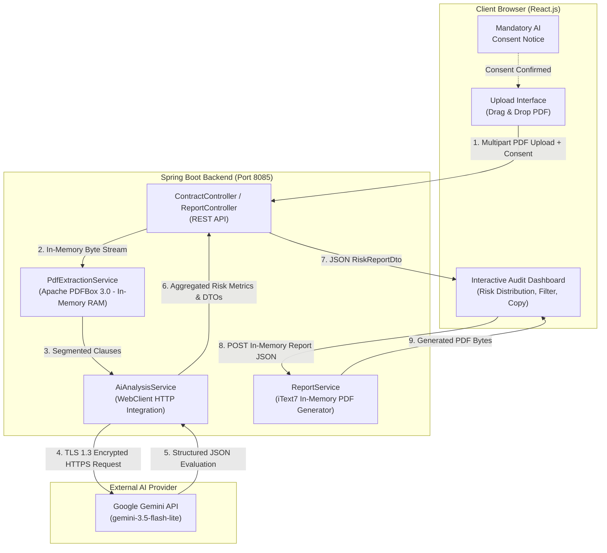

# ContractIQ – AI-Powered Contract Risk Analyzer

> **Privacy-First, Stateless Legal Risk Triage Platform**  
> Built with **Java 17**, **Spring Boot 3**, **Apache PDFBox**, **iText7**, **React.js**, and **Google Gemini AI**.

[](https://www.oracle.com/java/)
[](https://spring.io/projects/spring-boot)
[](https://react.dev/)
[](https://vitejs.dev/)
[](#4-privacy-architecture--honest-technical-disclosures)
[](#)

---

## 1. Project Overview

**ContractIQ** is a modern, privacy-first SaaS application designed for commercial contract risk triage. Commercial agreements (MSAs, NDAs, SLAs, Vendor Agreements) often contain unilateral liability caps, ambiguous indemnification clauses, and lopsided termination rights that expose organizations and individuals to legal liabilities.

Unlike conventional legal-tech platforms that store customer agreements in persistent cloud databases, ContractIQ implements an **ephemeral, stateless in-memory architecture**:
- Contract PDFs are parsed purely in volatile server memory using Apache PDFBox.
- Provisions are segmented into distinct clauses and analyzed via Google Gemini AI (`gemini-3.5-flash-lite`).
- Results are streamed directly back to the client and downloadable as an audit-ready PDF report generated on the fly via iText7.
- **Zero documents, clauses, user accounts, or reports are ever written to a persistent database or permanent server storage.**

---

## 2. Core Features

- **Stateless PDF Ingestion:** Upload commercial contracts up to 20 MB with immediate MIME and `%PDF-` signature verification.
- **In-Memory Clause Segmentation:** Identifies and extracts discrete contractual provisions (Indemnification, Limitation of Liability, Termination, Confidentiality, Warranties, Intellectual Property).
- **Gemini AI Risk Scoring:** Evaluates legal exposure and severity (0–100 score) with calibrated ratings:
  - 🔴 **HIGH RISK:** Uncapped indemnities, unilateral IP transfers, or unlimited liability.
  - 🟡 **MEDIUM RISK:** Ambiguous notice periods, broad confidentiality exclusions, or one-sided remedies.
  - 🟢 **LOW RISK:** Standard bilateral covenants and balanced commercial terms.
- **Actionable Counter-Proposals:** Generates balanced negotiation language and missing safeguard checklists with one-click clipboard copying.
- **Interactive Risk Scorecard:** Visual risk distribution donut powered by Recharts, executive contract summary, and searchable clause explorer with instant severity filters (`ALL`, `HIGH`, `MEDIUM`, `LOW`).
- **Stateless PDF Export:** Compiles an executive risk audit report into a downloadable PDF directly in volatile memory via iText7.
- **Zero-Persistence Privacy Guarantee:** No user accounts, no login required, no tracking cookies, and no persistent database tables.

---

## 3. System Architecture & Workflow

ContractIQ strictly adheres to a clean layered architecture (`Controller` → `Service` → `DTO` → `Exception Handler`) with zero persistent database dependencies.



### Complete Processing Flow

1. **Upload & Validation:** User selects a PDF document (validated for `%PDF-` magic bytes and max 20 MB size) and confirms mandatory AI disclosure consent.
2. **In-Memory Text Extraction:** `PdfExtractionService` loads the byte stream directly into Apache PDFBox (`PDDocument`) within a `try-with-resources` block. Text is stripped and segmented into clause blocks without disk writes.
3. **AI Risk Assessment:** `AiAnalysisService` calls Google Gemini AI (`gemini-3.5-flash-lite`) with a calibrated legal prompt to classify risk levels (`HIGH`, `MEDIUM`, `LOW`), assign severity scores (0–100), identify missing protections, and draft balanced revision language.
4. **Scoring & Triage:** `ContractService` computes aggregate risk distribution and produces a stateless `RiskReportDto`.
5. **Interactive Dashboard:** React renders the executive summary, Recharts risk breakdown donut, and searchable, expandable clause cards.
6. **On-Demand PDF Export:** User clicks "Download PDF Report", which posts the current in-memory report JSON to `ReportService`. iText7 builds a clean PDF in a `ByteArrayOutputStream` and streams it back as a file download.
7. **Immediate Resource Purge:** Temporary RAM buffers are reclaimed by garbage collection. No records remain on the server.

---

## 4. Privacy Architecture & Honest Technical Disclosures

| Area | Implementation & Accurate Behavior |
|---|---|
| **Zero Database Persistence** | ContractIQ has no database (no PostgreSQL, MySQL, H2, Redis). Zero tables, entities, or repositories exist. |
| **No Permanent Disk Storage** | The application never writes contracts or reports to permanent server directories or object storage. |
| **Multipart Upload Lifecycle** | Spring Boot / Tomcat buffers file parts below `file-size-threshold` (2MB) directly in memory. Uploads exceeding 2MB are temporarily spooled to the system temporary directory (`java.io.tmpdir`) and automatically deleted by Tomcat's `ApplicationPart.delete()` upon request completion. |
| **In-Memory Parsing & Disposal** | `PdfExtractionService` wraps `PDDocument` and byte streams in `try-with-resources`. Buffers are nulled after processing, and native resources are deterministically closed. |
| **No User Accounts / PII** | No authentication, no registration, no user profiles, no session tokens. All users access features anonymously. |
| **No Client-side Cache** | Zero usage of `localStorage` or `sessionStorage` for contracts or analysis data. All state lives only in React component memory. |
| **No Sensitive Logging** | Backend logs capture only operation metadata (e.g. character count, clause count, latency). Contract text and Gemini API keys are strictly excluded or masked (`[REDACTED]`). |
| **External AI Transmission** | Contract clauses are transmitted via HTTPS to Google's Gemini API (`gemini-3.5-flash-lite`). AI processing and retention are subject to Google Cloud's API terms and privacy policies. Users should not upload confidential documents without authorization. |
| **Server-Enforced Consent** | Backend strictly rejects requests (`400 Bad Request`) if `consent=true` is not confirmed by the caller. |

---

## 5. Technology Stack

### Backend
- **Language:** Java 17
- **Framework:** Spring Boot 3.2.0 (Spring Web, Spring Validation)
- **HTTP Client:** Spring WebFlux (`WebClient`) for non-blocking Gemini AI communication
- **PDF Extraction:** Apache PDFBox 3.0.1 (In-Memory text stripper)
- **PDF Report Generation:** iText7 Core 7.2.5 (In-Memory byte streaming)
- **JSON Serialization:** Jackson Databind 2.15+
- **Code Optimization:** Project Lombok

### Frontend
- **Framework:** React 18 (Functional components, Hooks)
- **Build Tool:** Vite 5 (Fast HMR & Rollup code-splitting)
- **Styling:** Tailwind CSS 3 (Clean, minimal B2B legal-tech aesthetic)
- **Visualizations:** Recharts 2 (Custom SVG donut & risk distribution chart)
- **File Upload:** React Dropzone 14 (Drag & drop with size/MIME validation)
- **Typography:** IBM Plex Sans & IBM Plex Mono (Google Fonts)

---

## 6. API Documentation

### 1. Health Check
- **Endpoint:** `GET /api/contracts/health`
- **Description:** Verifies service health, active AI provider, and stateless operating mode.
- **Response:** `200 OK`
```json
{
  "status": "UP",
  "service": "ContractIQ API",
  "persistence": "None (Stateless In-Memory Processing)",
  "aiProvider": "Google Gemini"
}
```

### 2. Analyze Contract (Stateless)
- **Endpoint:** `POST /api/contracts/analyze` (alias: `/api/contracts/upload`)
- **Content-Type:** `multipart/form-data`
- **Parameters:**
  - `file`: MultipartFile (PDF document, max 20 MB, starting with `%PDF-` signature)
  - `consent`: boolean (Query param or form field, must be `true`)
- **Response:** `200 OK`
```json
{
  "contractId": "3fa85f64-5717-4562-b3fc-2c963f66afa6",
  "originalFilename": "Master_Services_Agreement.pdf",
  "fileSizeBytes": 142050,
  "overallScore": 78,
  "riskCategory": "HIGH_RISK",
  "contractSummary": "Master Services Agreement governing cloud software licensing with unilateral indemnification and unlimited vendor liability.",
  "totalClauses": 14,
  "highRiskCount": 3,
  "mediumRiskCount": 5,
  "lowRiskCount": 6,
  "analyzedAt": "2026-11-22T14:04:38",
  "clauses": [
    {
      "id": "e4b2c1a0-9831-412e-9d2a-1188204910ab",
      "clauseIndex": 0,
      "clauseType": "Indemnification",
      "riskLevel": "HIGH",
      "riskScore": 88,
      "clauseText": "Vendor agrees to defend, indemnify, and hold harmless Customer from any claims without limitation.",
      "explanation": "Unilateral uncapped indemnity exposes vendor to disproportionate financial damages without reciprocal protection.",
      "missingProtections": "Mutual indemnity, liability cap carve-in, notice of claim requirements.",
      "suggestedRevision": "Each party shall indemnify the other against third-party claims arising from gross negligence, subject to the aggregate liability limit in Section 12."
    }
  ]
}
```

### 3. Export PDF Report
- **Endpoint:** `POST /api/reports/export`
- **Content-Type:** `application/json`
- **Accept:** `application/pdf`
- **Request Body:** `RiskReportDto` JSON payload.
- **Response:** `200 OK` (`Content-Type: application/pdf`, `Content-Disposition: attachment; filename="<originalFilename>-Risk-Report.pdf"`)

---

## 7. Installation & Setup Guide

### Prerequisites
- **Java Development Kit (JDK):** Version 17 or higher
- **Apache Maven:** Version 3.8+
- **Node.js:** Version 18+ and `npm`
- **Google Gemini API Key:** Key from [Google AI Studio](https://aistudio.google.com/)

---

### Step 1: Environment Variables

Set your Gemini API credentials in your environment or terminal:

**Windows PowerShell:**
```powershell
$env:GEMINI_API_KEY="your_gemini_api_key_here"
```

**Linux / macOS:**
```bash
export GEMINI_API_KEY="your_gemini_api_key_here"
```

*(Optional variables: `SERVER_PORT=8085`, `FRONTEND_URL=http://localhost:5173`)*

---

### Step 2: Backend Setup (Spring Boot)

Navigate to the `backend` directory, build, and run:

```bash
cd backend
mvn clean install
mvn spring-boot:run
```

The Spring Boot backend initializes without any database setup on port **8085**:
```
Tomcat started on port 8085 (http) with context path ''
Started ContractRiskApplication in 3.5 seconds
```

Run backend unit & integration tests:
```bash
mvn test
```

---

### Step 3: Frontend Setup (React.js + Vite)

In a separate terminal, navigate to the `frontend` directory:

```bash
cd frontend
npm install
npm run dev
```

The frontend development server starts on:
```
http://localhost:5173
```

To create an optimized production build:
```bash
npm run build
```

---

## 8. User Interface & Application Screenshots

The ContractIQ user interface is designed following modern B2B SaaS principles, featuring a restrained slate palette, dark typography, and accessible visual hierarchy:

| View | Description |
|---|---|
| **Landing & In-Memory Upload Workspace** | Above-the-fold layout with drag-and-drop PDF dropzone, file metadata preview, and explicit AI disclosure consent checkbox. |
| **Executive Risk Scorecard** | Calibrated 0–100 overall contract risk rating, severity categorization (`HIGH_RISK`, `MODERATE_RISK`, `LOW_RISK`), and executive summary. |
| **Interactive Risk Distribution** | Recharts SVG donut chart visualizing proportional breakdown of high, medium, and low-risk provisions. |
| **Clause-by-Clause Explorer** | Expandable accordions with original text, risk analysis, omitted protections, and one-click copyable redline counter-language. |
| **Stateless PDF Audit Report** | Clean, audit-ready PDF summary document generated in-memory via iText7 for legal counsel markup and stakeholder review. |

---

## 9. Technical Interview Talking Points

When presenting ContractIQ in a **Java Full Stack Developer** interview, highlight these architectural decisions:

1. **Why Stateless In-Memory Architecture?**  
   Commercial contracts carry strict Non-Disclosure Agreement (NDA) liabilities. Persisting documents in PostgreSQL or S3 introduces data retention compliance hurdles (GDPR Article 17, SOC 2 compliance). By designing the backend as an ephemeral pipeline using Java `InputStream` and PDFBox memory loading, we guarantee zero data footprint while lowering cloud storage costs to zero.

2. **Resource Management & JVM Garbage Collection:**  
   Contract uploads can reach 20 MB. We leverage Java `try-with-resources` to ensure `PDDocument` and byte streams close deterministically, preventing native memory leaks and letting the JVM promptly collect intermediate buffers.

3. **External API Resilience & Rate-Limiting:**  
   Google Gemini's free tier imposes rate limits (HTTP 429). The `AiAnalysisService` incorporates an exponential backoff retry mechanism (5s, 12s, 25s) with a 90-second non-blocking timeout via Spring WebFlux `WebClient`, ensuring graceful recovery without thread starvation.

4. **iText7 In-Memory PDF Generation:**  
   Rather than saving PDF reports to a file directory and serving a static download URL, the report generation takes the client's current in-memory report JSON and writes the document straight to a `ByteArrayOutputStream`. The byte array is streamed back with `Content-Type: application/pdf` and cache-control headers.

5. **Clean Separation of Concerns:**  
   Spring Boot strictly separates HTTP transport (`Controller`), business rules (`ContractService`), external AI orchestration (`AiAnalysisService`), PDF text extraction (`PdfExtractionService`), and document formatting (`ReportService`), making each component independently testable with JUnit 5 and Mockito.

---

## 10. Known Limitations & Future Improvements

- **Scanned Image-Only PDFs:** Current extraction relies on digital text layers via PDFBox. Scanned contracts without OCR layers will prompt an informative notice. Adding Tesseract OCR / cloud OCR is planned for a future release.
- **Multi-Document Comparison:** Currently analyzes one agreement at a time. Future releases will support side-by-side comparison between customer and vendor redline drafts.
- **Custom Risk Rulebooks:** Allowing legal teams to supply custom policy checklists (e.g., "Always require 30-day notice for termination") to guide Gemini's evaluation.

---

## 11. Legal Disclaimer

ContractIQ is an automated contract analysis and risk triage platform intended for informational and initial review purposes only. It does not provide legal advice, establish an attorney-client relationship, or substitute for formal consultation with licensed legal professionals.
