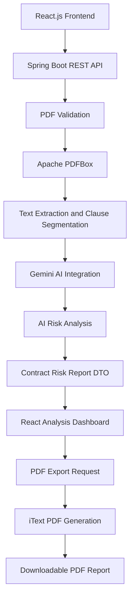

# ContractIQ – AI-Powered Contract Risk Analyzer

An AI-powered contract analysis application that extracts clauses from PDF documents, evaluates potential contractual risks using Google Gemini, and generates downloadable PDF reports.

## Overview

ContractIQ helps users review contracts by identifying potentially risky clauses and providing AI-generated explanations and suggested revisions.

The application uses a React.js frontend and a Java Spring Boot backend. Uploaded PDF documents are processed by the backend, their text is extracted using Apache PDFBox, and the extracted clauses are sent to the Google Gemini API for analysis.

The application does not use a database or provide user registration and login functionality. Analysis results are returned to the frontend and can be downloaded as PDF reports.

## Features

- **PDF Contract Upload:** Upload PDF contracts using a drag-and-drop interface.
- **PDF Text Extraction:** Extract readable text from PDF documents using Apache PDFBox.
- **AI-Powered Analysis:** Integrate Google Gemini API to evaluate contract clauses.
- **Risk Classification:** Classify identified clauses into High, Medium, and Low risk categories.
- **Risk Scoring:** Generate an overall contract risk score based on analyzed clauses.
- **Contract Summary:** Generate AI-powered summaries of uploaded contracts.
- **Clause-Level Insights:** Display risk explanations, missing protections, and suggested revisions.
- **Interactive Dashboard:** View risk statistics and filter clauses by risk level.
- **PDF Report Generation:** Generate and download contract analysis reports.
- **Privacy-Conscious Processing:** Avoid persistent database storage of uploaded contracts and analysis results.
- **Consent Validation:** Require acknowledgement of external AI processing before contract analysis.

## Technology Stack

### Backend
- Java 17
- Spring Boot 3.2.0
- Spring MVC
- Spring WebFlux WebClient
- Spring Validation
- Apache PDFBox 3.0.1
- iText 7.2.5
- Jackson
- Lombok
- Maven

### Frontend
- React.js 18
- JavaScript
- HTML5
- CSS3
- Tailwind CSS
- Vite
- Axios
- React Router
- React Dropzone
- Recharts

### AI Integration
- Google Gemini API

## Application Architecture

The application follows a layered backend architecture with separate responsibilities for controllers, services, DTOs, configuration, and exception handling.



## How It Works

1. **Upload Contract:** The user selects a PDF contract and acknowledges the external AI processing disclosure.
2. **Validate Document:** The Spring Boot backend validates the uploaded file, its PDF signature, and its size.
3. **Extract Text:** Apache PDFBox extracts readable text from the uploaded PDF.
4. **Identify Clauses:** The extracted text is segmented into individual clause sections.
5. **AI Analysis:** Contract clauses and the document filename are included in a prompt sent to the Google Gemini API over HTTPS.
6. **Risk Assessment:** Gemini returns structured analysis containing risk classifications, explanations, missing protections, and suggested revisions.
7. **Display Results:** The React frontend displays the contract summary, overall risk score, and clause-level analysis.
8. **Export Report:** The user can generate and download a PDF report using the backend PDF generation service.

## Privacy and Data Handling

ContractIQ is designed to avoid persistent application-level storage of uploaded contracts and analysis results.

The current implementation has the following behavior:

| Area | Implementation |
|---|---|
| Database | No database integration |
| User accounts | No registration or login |
| Contract storage | No application-managed permanent contract storage |
| PDF processing | Apache PDFBox processes extracted document content in memory |
| Multipart uploads | Spring Boot uses a 2 MB memory buffering threshold |
| Temporary files | Larger multipart uploads may be temporarily stored in the servlet container's temporary directory |
| Analysis results | Returned to the frontend without database persistence |
| Frontend state | Analysis data is maintained in React component state |
| Report generation | PDF generated using an in-memory byte stream |
| External AI | Contract clauses and filename are transmitted to Google Gemini API |

### Important Privacy Considerations

- The application does not intentionally maintain a permanent contract history.
- Uploaded files larger than the configured multipart threshold may temporarily be written to server temporary storage.
- Temporary multipart resources are managed by the servlet container. Their cleanup should be verified in the deployment environment.
- Contract contents and analysis results are not intentionally written to an application database.
- The frontend does not use localStorage or sessionStorage for contract analysis data.
- The backend currently logs uploaded filenames during analysis and report export. Filenames may contain sensitive information, so these logging statements should be removed or further restricted before handling confidential documents.
- Contract clauses and the filename are transmitted to Google's Gemini API for analysis.
- External processing and retention are governed by Google's applicable API terms and policies.

**Important:** This application does not guarantee that data is never written to disk or that external AI providers do not retain submitted information. Users should avoid uploading confidential documents unless they understand and accept the external processing involved.

## API Endpoints

The backend exposes the following REST endpoints.

### 1. Health Check

**GET** `/api/contracts/health`

Checks whether the backend application is responding.

Example response:

```json
{
  "status": "UP",
  "service": "ContractIQ API",
  "persistence": "None (Stateless In-Memory / Ephemeral Processing)",
  "aiProvider": "Google Gemini"
}
```

### 2. Analyze Contract

**POST** `/api/contracts/analyze`

Alternative endpoint: `/api/contracts/upload`

Content-Type: `multipart/form-data`

Parameters:

| Parameter | Type | Description |
|---|---|---|
| file | PDF file | Contract document (maximum 20 MB) |
| consent | Boolean | Must be true to acknowledge external AI processing |

Example using cURL:

```bash
curl -X POST http://localhost:8085/api/contracts/analyze \
  -F "file=@sample-contract.pdf" \
  -F "consent=true"
```

The endpoint returns a JSON report containing:

- Contract ID
- Original filename
- File size
- Overall risk score
- Risk category
- Contract summary
- Total clauses analyzed
- High, Medium, and Low risk counts
- Clause-level explanations
- Missing protections
- Suggested revisions

### 3. Export PDF Report

**POST** `/api/reports/export`

Content-Type: `application/json`

Accept: `application/pdf`

Accepts the generated risk report JSON and returns a downloadable PDF document.

The report is generated using iText and returned as PDF bytes.

## Project Structure

```text
ContractIQ/
│
├── backend/
│   ├── src/
│   │   ├── main/
│   │   │   ├── java/com/contractrisk/
│   │   │   │   ├── config/
│   │   │   │   ├── controller/
│   │   │   │   ├── dto/
│   │   │   │   ├── exception/
│   │   │   │   ├── service/
│   │   │   │   └── ContractRiskApplication.java
│   │   │   │
│   │   │   └── resources/
│   │   │       └── application.properties
│   │   │
│   │   └── test/
│   │
│   └── pom.xml
│
├── frontend/
│   ├── src/
│   │   ├── api/
│   │   ├── components/
│   │   ├── pages/
│   │   ├── App.jsx
│   │   ├── index.css
│   │   └── main.jsx
│   │
│   ├── package.json
│   └── vite.config.js
│
├── .gitignore
└── README.md
```

## Installation and Setup

### Prerequisites

Install the following:

- Java Development Kit (JDK) 17
- Apache Maven
- Node.js
- npm
- Google Gemini API key

### 1. Clone the Repository

```bash
git clone https://github.com/ShreyasBK04/ContractIQ-AI_Powered_Contract-_Risk-_Analyzer.git

cd ContractIQ-AI_Powered_Contract-_Risk-_Analyzer
```

### 2. Configure Gemini API Key

Get an API key from Google AI Studio:

https://aistudio.google.com/

Set the API key as an environment variable.

**Windows PowerShell:**

```powershell
$env:GEMINI_API_KEY="your_api_key"
```

**Linux / macOS:**

```bash
export GEMINI_API_KEY="your_api_key"
```

Never commit your API key to GitHub.

### 3. Start the Backend

Open a terminal:

```bash
cd backend
```

Build the backend:

```bash
mvn clean package
```

Run the Spring Boot application:

```bash
mvn spring-boot:run
```

Backend URL:

```text
http://localhost:8085
```

Health endpoint:

```text
http://localhost:8085/api/contracts/health
```

### 4. Start the Frontend

Open another terminal:

```bash
cd frontend
```

Install dependencies:

```bash
npm install
```

Start the React development server:

```bash
npm run dev
```

Frontend URL:

```text
http://localhost:5173
```

### 5. Frontend API Configuration

The frontend uses the following environment variable to configure the backend URL:

```env
VITE_API_URL=http://localhost:8085
```

If it is not configured, the frontend defaults to `http://localhost:8085`.

## Testing

### Backend Tests

Run the backend tests:

```bash
cd backend
mvn clean test
```

### Frontend Production Build

Run:

```bash
cd frontend
npm run build
```

These commands verify the backend test suite and frontend production compilation respectively. Live Gemini API integration and complete end-to-end behavior require separate testing with a configured API key and running application.

## Known Limitations

- Only PDF documents are supported.
- Scanned PDFs without an extractable text layer are not supported because OCR is not currently implemented.
- Contract analysis depends on Google Gemini API availability and response quality.
- AI-generated risk assessments may be inaccurate or incomplete.
- Contract text extraction and clause segmentation use text-based processing and may not preserve every legal document structure.
- The application analyzes one contract at a time.
- No user accounts or saved analysis history are provided.
- Multipart uploads may use temporary server storage depending on file size.
- The application does not provide professional legal advice.

## Future Improvements

- OCR support for scanned PDF documents.
- More comprehensive automated testing.
- Improved clause segmentation.
- Real-time analysis progress reporting.
- Additional contract risk assessment rules.
- More detailed error reporting and API monitoring.
- Further improvements to temporary file handling and privacy controls.

## Legal Disclaimer

ContractIQ is an educational and informational contract analysis application.

The AI-generated summaries, risk classifications, explanations, and suggested revisions are provided for preliminary review purposes only.

The application does not provide legal advice and should not replace review by a qualified legal professional.

---

**Developed as a Java Full Stack project using Spring Boot, React.js, and Google Gemini API.**
